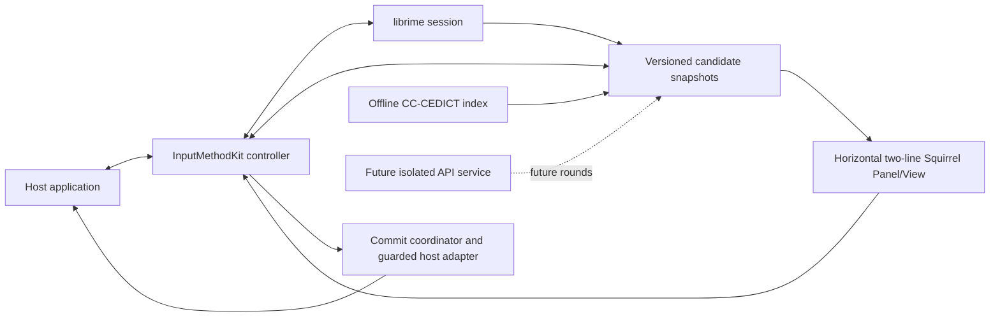

# 两仪 / EcholME

A macOS input method derived from [Squirrel](https://github.com/rime/squirrel), powered by [librime](https://github.com/rime/librime). The intended experience pairs Chinese candidates with English subtitles, and English candidates with Chinese subtitles. **Round 2 shows subtitles from a pinned offline CC-CEDICT index. One displayed sense is the committed translation. It is not a cloud API or a complete professional dictionary.**

Minimum deployment target: macOS 14. Swift is the main frontend language. The English product spelling is **EcholME**. This is an independent derivative, not an official Squirrel release.

## English

### Project records

- [Approved full plan](docs/project/PLAN.md): reuse, changes, new modules, rounds, risks, acceptance, and GPL distribution work.
- [Delivery status](docs/project/STATUS.md), [Round 3 delivery](docs/round3/DELIVERY.md), [Round 2 delivery](docs/round2/DELIVERY.md), and [Round 1 delivery](docs/round1/DELIVERY.md): distinguish implementation, build, installation and actual input.
- [Round 1 key contract](docs/round1/KEY_CONTRACT.md) and [installation/acceptance steps](docs/round1/MANUAL_ACCEPTANCE.md).
- [Runtime acceptance](docs/round0/RUNTIME_ACCEPTANCE.md) and [manual installation/input checks](docs/round0/MANUAL_ACCEPTANCE.md): follow these before enabling an earlier development artifact.
- [Decisions](docs/project/DECISIONS.md) and [Round 0 foundation](docs/round0/FOUNDATION.md): identity, architecture, safe commands, and limitations.
- [Upstream provenance](UPSTREAM.md), [changes](CHANGES_FROM_UPSTREAM.md), and [third-party notices](THIRD_PARTY_NOTICES.md).
- [Open-source references and learning record](docs/project/REFERENCES.md): direct Squirrel/librime reuse and comparison references from Metasequoia, McBopomofo and Fcitx5 macOS.

### Architecture

The Squirrel internal module/class names remain to limit divergence. App identity, input sources, notifications, data and logs are independent. Chinese Space/digits keep engine selection/recognizers; English Space commits a token plus one space, and digits extend the token. Return commits raw composition without newline; empty Return belongs to the host. Esc cancels. **Option+Return** submits a ready subtitle only when it matches the verified full commit scope. Tab/Command finalize raw then pass to the host.

Tap Left Shift alone (within 0.5 seconds) to finalize raw composition once and switch Chinese/English. Right Shift alone retains the Rime schema binding; the baseline commits the Chinese candidate, while frontend English is finalized first. Either Shift used with a typed key, another modifier, the other Shift, or a long hold does not switch. The input menu's Local translations toggle disables subtitles and restores direct ASCII passthrough; its state is per controller. Unknown words show `—`, pending results show `…`, and a dictionary timeout shows `!`. Round 3 adds local context detection; no cloud API is implemented. See the full key contract before testing English punctuation, email/URL/code or Chinese recognizers.

Starting with 0.0.6, the input-source menu also offers **中文主输入 / Chinese** and **英文主输入 / English**, with a checkmark on the current language. Selecting a different language finalizes pending raw text once; reselecting the current language leaves it pending. The menu-bar status and candidate footer identify the primary language. To type `hello` as English, select English before typing: Return submits `hello`, Space submits `hello` plus a space, and Option+Return submits its ready Chinese subtitle. These controls require the repaired bundle to be installed; see the [current acceptance guide](docs/round3/MANUAL_ACCEPTANCE.md).

### Automatic direction and manual control (0.0.8)

Choose **Auto** for field-first detection, **Chinese** or **English** for a persistent explicit language, or **Off** to finish pending raw text and pass subsequent keys directly to the host. Shift overrides the current focus; selecting Auto or activating a new field ends that temporary override. Manual language changes retain the guarded Round 1 commit behavior. Automatic results never change a live composition.

Auto resolves safety → manual choice → saved app rule → field/nearby text → opt-in learned preference → built-in app default → global fallback (Chinese). Xcode, Terminal and iTerm default to English only when higher-priority evidence is absent. Empty, short or ambiguous mixed text falls back; the classifier is a Chinese/Latin-script hint, not semantic identification of every language. Explicit Chinese mode is not required to preserve email/URL/code literally.

**Language & App Rules…** edits modes, fallback and exact bundle-ID rules. Learning is off by default and stores only an app ID, direction and a capped count. Settings use the EcholME UserDefaults domain and a versioned JSON value, bounded to 128 app IDs and 64 KiB. Rules replace legacy `app_options/ascii_mode`; other Rime options remain supported. **About EcholME / Open Source Licenses…** opens the bundled notices.

Auto reads at most 128 UTF-16 units before an empty caret through bounded background AX range queries at activation, or on an idle Auto selection when evidence is missing. No full-field value, selection, title or document URL attribute is read; no permission prompt occurs. With no AX access, normal input and rule/default fallback still work. Explicit modes use safety metadata only; Off schedules no context capture. Known secure fields and Secure Event Input bypass composition and translations. Unknown or nonstandard host security metadata cannot be independently guaranteed. Context text is transient, is not logged/persisted, and never leaves the process. A late result after typing/focus changes is discarded rather than learning from the IME own preedit. Later edits to the surroundings generally require field/input-source reactivation to resample. The short mode HUD is implemented; installed geometry and physical keyboard acceptance remain pending.

In 0.0.8, releasing temporary Secure Event Input triggers a bounded, metadata-only field recheck. Input remains literal and translation stays disabled while that check is pending. An outdated focus result retains protection until a new field/input-source activation; a known AX secure field stays protected. Missing permission or unsupported/timed-out metadata uses the existing fallback policy and is not proof that the field is non-sensitive. No context text is read for this recovery check.

`python3 -B tools/check_round3.py` runs synthetic context and preference checks plus prior offline regressions; it does not install, read real documents or grant permissions. The [Round 3 report](docs/round3/DELIVERY.md) records current validation and limitations.

### Build and install

Use full Xcode with the macOS SDK and Python 3. The reviewed build entry point remains `tools/round0.py`; see [Round 1 delivery](docs/round1/DELIVERY.md) for commands, evidence and environment. `python3 -B tools/check_round1.py` runs isolated state/host/layout checks without installing or accessing Rime databases. Its optional `--engine-bundle` uses fresh approved LiangYi validation directories. Do not run the inherited Makefile install/clean/package targets or `action-build.sh` / `action-install.sh` for EcholME: they contain destructive replacement or dynamic dependency operations.

The first-install destination is `~/Library/Input Methods/EcholME.app`. Registration, enabling, selection, and actual input are separate checks. The installer refuses an existing destination; it does not delete, move, or replace an earlier installation. A stale macOS input-source cache may require the user to log out and back in.

Independent paths:

| Purpose | Location |
| --- | --- |
| Input method | `~/Library/Input Methods/EcholME.app` |
| Rime configuration and user dictionary | `~/Library/Application Support/LiangYi/Rime` |
| Logs | `~/Library/Logs/LiangYi` |
| Input-source IDs | `io.github.zhenkun26.inputmethod.EcholME.Hans` / `.Hant` |

The baseline uses Luna Pinyin Simplified, with Stroke as an auxiliary dependency. The traditional input-source entry is an inherited registration mode, not a separately validated traditional-Chinese product. Existing Squirrel configuration is not migrated.

### Permissions, diagnostics, and recovery

Basic IMK input does not require a new Accessibility grant. The optional standalone capability probe reports TIS state and AX role/range capabilities; it never reads document text or requests permission. AX permission for the probe does not establish permission for the IME itself. Development signing is ad hoc; the app is not sandboxed or notarized. The inherited updater is disabled.

The current [installation and acceptance guide](docs/round3/MANUAL_ACCEPTANCE.md) lists pending real-input checks; the [Round 0 record](docs/round0/VERIFICATION.md) preserves historical baseline troubleshooting. A compiled bundle does not by itself prove macOS 14 compatibility, Intel runtime support, coexistence with a running Squirrel, or correct input in every host.

To stop using this development build, select ABC or another working input source, then remove EcholME from the enabled list in System Settings > Keyboard > Text Input. No automated file-removal command is supplied under this project's no-deletion policy. Any removal of the bundle or user data is left to the user, and user dictionaries should be preserved.

### License and contributions

The inherited Squirrel license is [GNU GPL version 3](LICENSE.txt). Original authors and notices are retained; [the original README](docs/upstream/README.squirrel.md) preserves upstream acknowledgments. Dependencies and data keep their own grants. Before any external binary distribution, prepare the exact corresponding source, build scripts, notices, and dependency materials described in [THIRD_PARTY_NOTICES.md](THIRD_PARTY_NOTICES.md); a link to upstream alone is not a complete release procedure.

No push or release is authorized by the current Round 3 request. Inherited upstream CI/release jobs are guarded against running in a derived repository. Each later round requires user confirmation.

## 简体中文

两仪是基于 [Squirrel（鼠须管）](https://github.com/rime/squirrel) 和 [librime](https://github.com/rime/librime) 的独立 macOS 输入法衍生项目，英文名为 **EcholME**。目标体验为中文候选下显示英文、英文候选下显示中文。**Round 2 使用固定版本的离线 CC-CEDICT 索引显示副标题。屏幕上的那一条释义就是可提交的译文，它不是云 API，也不是完整的专业词典。** 最低部署目标为 macOS 14，前端以 Swift 为主；本项目不是 Squirrel 官方发行版。

### 项目记录与架构

- [完整计划](docs/project/PLAN.md)：复用、改造、新增模块、各轮交付、风险、验收及 GPL 分发事项。
- [交付状态](docs/project/STATUS.md)、[Round 3 交付](docs/round3/DELIVERY.md)、[Round 2 交付](docs/round2/DELIVERY.md)与[Round 1 交付](docs/round1/DELIVERY.md)：分别报告代码、构建、安装和实际输入。
- [Round 1 按键约定](docs/round1/KEY_CONTRACT.md)与[安装／验收步骤](docs/round1/MANUAL_ACCEPTANCE.md)。
- [运行验收](docs/round0/RUNTIME_ACCEPTANCE.md)与[手动安装／输入检查](docs/round0/MANUAL_ACCEPTANCE.md)：启用旧开发包前先按此核对和更新。
- [技术决策](docs/project/DECISIONS.md)与[本轮基础说明](docs/round0/FOUNDATION.md)：身份、架构、操作命令和限制。
- [上游来源](UPSTREAM.md)、[改动说明](CHANGES_FROM_UPSTREAM.md)与[第三方声明](THIRD_PARTY_NOTICES.md)。
- [开源项目参考与学习记录](docs/project/REFERENCES.md)：区分直接复用的 Squirrel／librime，以及水杉、小麦注音、Fcitx5 macOS 等比较与学习参考。

当前链路为宿主应用 → InputMethodKit → librime／英文词组合 → 带版本的候选快照 → 横向双行 Squirrel Panel/View → 统一上屏协调器。内部保留 Squirrel 模块及类名，应用身份、输入源、通知、数据和日志均独立。

中文空格／数字保留引擎选词及识别规则；英文空格提交词及一个空格，数字继续输入。组合中的回车提交原始字母而不换行，空组合回车交给宿主；Esc 取消。**Option+Return** 仅上屏已显示、已就绪且通过完整范围检查的词典译文。Tab／Command 先提交原文再交给宿主。

在 0.5 秒内单独轻按左 Shift，先提交原始组合一次，再切换中英文。右 Shift 单独轻按保留 Rime 方案绑定：当前基线提交中文候选，前端英文组合则先提交原文。左右 Shift 配合输入、其他修饰键、另一个 Shift 或长按时均不切换模式。“Local translations” 菜单开关关闭副标题时恢复英文直通，其状态仅属于当前控制器。未命中显示 `—`，等待中显示 `…`，词典超时显示 `!`。Round 3 新增本地环境识别，云 API 尚未实现；邮箱、网址、代码和中文识别规则应按完整按键约定验收。

从 0.0.6 起，输入源菜单还提供 **中文主输入 / Chinese** 和 **英文主输入 / English**，以勾选标明当前语言。选择另一种语言会先提交待输入的原始文字一次；重复选择当前语言保留待输入文字。菜单栏状态和候选窗底部均标明主语言。要原样输入 `hello`，先选择英文：回车提交 `hello`，空格提交 `hello` 及一个空格，Option+Return 提交已就绪的中文译文。这些入口需安装修复包后才能使用，见[当前验收指南](docs/round3/MANUAL_ACCEPTANCE.md)。

### 自动方向与手动控制（0.0.8）

选择 **Auto** 按输入框优先判断；**Chinese / English** 固定主语言；**Off** 先提交待输入的原始文字，再让按键直接交给宿主。Shift 的手动覆盖在当前焦点有效，选择 Auto 或激活新输入框后结束。手动切换沿用 Round 1 的上屏保护，自动结果不会改变正在输入的组合。

优先级为：安全限制 → 手动选择 → 应用强制规则 → 字段／附近文字 → 自愿开启的学习偏好 → 内置应用默认值 → 全局默认值（中文）。Xcode、Terminal、iTerm 仅在没有更高优先级证据时默认英文。空白、短片段或模糊混合文字会回退；识别是中文／拉丁字母倾向判断，不能区分所有自然语言。显式中文模式不承诺原样保留邮箱、网址和代码。

**Language & App Rules…** 可编辑模式、默认值和精确 Bundle ID 规则。学习默认关闭，仅记录应用 ID、方向和有上限的次数。设置存于 EcholME 的 UserDefaults 域，使用版本化 JSON，限制为 128 个应用 ID、64 KiB。新规则统一接管旧 `app_options/ascii_mode`，其余 Rime 选项仍保留。**About EcholME / Open Source Licenses…** 提供包内声明入口。

Auto 在激活时，或空组合下选择 Auto 且缺少证据时，通过后台 AX 范围接口临时读取空光标前最多 128 个 UTF-16 单元；不读取整框内容、选中文字、标题或网址属性，不主动申请权限。没有辅助功能权限时，正常输入及规则／默认值回退仍可用。显式语言只检查安全元数据；Off 不发起上下文读取。已知安全字段及 Secure Event Input 会绕过组合和翻译；宿主未提供或自定义的安全标记无法独立保证识别。附近文字不写日志、不持久化、不发送到进程外。输入或焦点变化后迟到的结果会被丢弃，避免自身拼音影响后续方向；后续修改附近文字后，通常需重新进入输入框／输入源取样。短暂模式 HUD 已实现，安装后的定位与物理键盘表现仍待验收。

0.0.8 在临时 Secure Event Input 解除后，会进行有时限的字段元数据复查。等待期间按键原样直通，翻译保持关闭；若结果来自已经变化的焦点，则继续保护，直到重新激活输入框或输入源。已知 AX 安全字段仍保持保护。无权限、不支持或超时会使用既有回退策略，不代表已确认字段不敏感。恢复复查不读取上下文文字。

`python3 -B tools/check_round3.py` 运行合成上下文、偏好存储和之前的离线回归，不安装、不读取真实文档、不授予权限。当前验证和限制见 [Round 3 报告](docs/round3/DELIVERY.md)。

### 构建与安装

需要完整 Xcode、macOS SDK 和 Python 3。已审查的构建入口仍是 `tools/round0.py`，具体命令、环境与证据见 [Round 1 交付](docs/round1/DELIVERY.md)。`python3 -B tools/check_round1.py` 运行独立的状态、宿主适配器和布局检查，不安装输入法，也不访问 Rime 数据库；可选 `--engine-bundle` 使用两仪目录下独立的新验收数据目录。不要使用继承的 Makefile install/clean/package 或 `action-build.sh`、`action-install.sh`，其中包含删除替换或动态依赖操作。

首次安装目标为 `~/Library/Input Methods/EcholME.app`。注册、启用、选中与实际输入分别验收。目标存在时安装器会停止，不删除、移动或覆盖旧安装；系统输入源缓存未刷新时可能需要用户注销后重新登录。

Rime 配置和用户词库位于 `~/Library/Application Support/LiangYi/Rime`，日志位于 `~/Library/Logs/LiangYi`。输入源为 `io.github.zhenkun26.inputmethod.EcholME.Hans` / `.Hant`。本轮使用朙月拼音简化字，笔画作为辅助依赖；繁体输入源入口是继承的注册模式，并不表示已完成独立繁体验收。不会迁移现有 Squirrel 配置。

### 权限、诊断与恢复

基础 IMK 输入不需要新增辅助功能授权。可选的独立能力探针仅报告 TIS 状态、AX 角色及范围能力，不读取文档内容，也不主动请求权限；探针拥有权限不等于输入法拥有权限。开发包使用本地 ad-hoc 签名，未开启沙盒，未公证，继承的自动更新功能已关闭。

当前[安装／验收指南](docs/round3/MANUAL_ACCEPTANCE.md)列出实际输入的待验收项，[Round 0 记录](docs/round0/VERIFICATION.md)保留历史基线的故障排查。编译成功不等于已验证 macOS 14、Intel、与运行中的 Squirrel 共存或所有宿主应用的输入。

如需停用，先切换到 ABC 等可用输入源，再从“系统设置 > 键盘 > 文本输入”移除两仪。遵循本项目不删除文件的约定，不提供自动删除脚本；应用包和用户数据的删除由用户自行决定，并应保留用户词库。

### 许可证与贡献

继承的 Squirrel 许可证为 [GNU GPL 第 3 版](LICENSE.txt)。保留上游作者及声明，[原始 README](docs/upstream/README.squirrel.md)保存完整致谢。依赖和数据分别适用各自许可证。首次对外分发二进制前，必须按[第三方声明](THIRD_PARTY_NOTICES.md)准备对应的完整源码、构建脚本、声明和依赖材料，不能仅以一个上游链接代替发布流程。

本次 Round 3 请求未授权推送或发布。继承的上游 CI/发布任务已限制为仅在上游仓库执行。后续每轮均须用户确认后开始。
