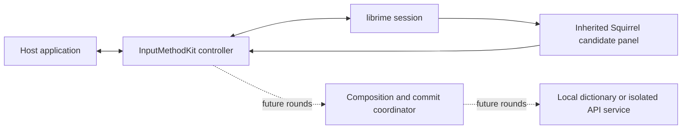

# 两仪 / EcholME

A macOS input method derived from [Squirrel](https://github.com/rime/squirrel), powered by [librime](https://github.com/rime/librime). The intended experience pairs Chinese candidates with English subtitles, and English candidates with Chinese subtitles. **Round 0 establishes the inherited Chinese input baseline only; translation is not implemented.**

Minimum deployment target: macOS 14. Swift is the main frontend language. The English product spelling is **EcholME**. This is an independent derivative, not an official Squirrel release.

## English

### Project records

- [Approved full plan](docs/project/PLAN.md): reuse, changes, new modules, rounds, risks, acceptance, and GPL distribution work.
- [Delivery status](docs/project/STATUS.md) and [verification evidence](docs/round0/VERIFICATION.md): distinguish build, installation, registration, and real input.
- [Decisions](docs/project/DECISIONS.md) and [Round 0 foundation](docs/round0/FOUNDATION.md): identity, architecture, safe commands, and limitations.
- [Upstream provenance](UPSTREAM.md), [changes](CHANGES_FROM_UPSTREAM.md), and [third-party notices](THIRD_PARTY_NOTICES.md).

### Architecture

Round 0 retains the Squirrel internal module/class names to limit divergence. The app, input-source identifiers, notifications, data, and logs use the independent EcholME identity. No translation, automatic language detection, cloud request, or new key binding is included in this round.

### Build and install

Use full Xcode with the macOS SDK and Python 3. The reviewed entry point is `tools/round0.py`; see [FOUNDATION.md](docs/round0/FOUNDATION.md) for commands and [VERIFICATION.md](docs/round0/VERIFICATION.md) for the exact tested environment. Do not run the inherited Makefile install/clean/package targets or `action-build.sh` / `action-install.sh` for EcholME: they contain destructive replacement or dynamic dependency operations.

The first-install destination is `~/Library/Input Methods/EcholME.app`. Registration, enabling, selection, and actual input are separate checks. The installer refuses an existing destination; it does not delete, move, or replace an earlier installation. A stale macOS input-source cache may require the user to log out and back in.

Independent paths:

| Purpose | Location |
| --- | --- |
| Input method | `~/Library/Input Methods/EcholME.app` |
| Rime configuration and user dictionary | `~/Library/Application Support/LiangYi/Rime` |
| Logs | `~/Library/Logs/LiangYi` |
| Input-source IDs | `io.github.zhenkun26.inputmethod.EcholME.Hans` / `.Hant` |

The baseline uses Luna Pinyin Simplified, with Stroke as an auxiliary dependency. The traditional input-source entry is an inherited registration mode, not a separately validated traditional-Chinese product. Existing Squirrel configuration is not migrated.

### Permissions, diagnostics, and recovery

Basic IMK input does not require a new Accessibility grant. The optional standalone capability probe reports TIS state and AX role/range capabilities; it never reads document text or requests permission. AX permission for the probe does not establish permission for the IME itself. Development signing is ad hoc; the app is not sandboxed or notarized. The inherited updater is disabled.

The complete [acceptance and troubleshooting record](docs/round0/VERIFICATION.md) lists blocked or unperformed checks. A compiled bundle does not by itself prove macOS 14 compatibility, Intel runtime support, coexistence with a running Squirrel, or correct input in every host.

To stop using this development build, select ABC or another working input source, then remove EcholME from the enabled list in System Settings > Keyboard > Text Input. No automated file-removal command is supplied under this project's no-deletion policy. Any removal of the bundle or user data is left to the user, and user dictionaries should be preserved.

### License and contributions

The inherited Squirrel license is [GNU GPL version 3](LICENSE.txt). Original authors and notices are retained; [the original README](docs/upstream/README.squirrel.md) preserves upstream acknowledgments. Dependencies and data keep their own grants. Before any external binary distribution, prepare the exact corresponding source, build scripts, notices, and dependency materials described in [THIRD_PARTY_NOTICES.md](THIRD_PARTY_NOTICES.md); a link to upstream alone is not a complete release procedure.

No push or release is authorized by the current Round 0 request. Inherited upstream CI/release jobs are guarded against running in a derived repository. Each later round requires user confirmation.

## 简体中文

两仪是基于 [Squirrel（鼠须管）](https://github.com/rime/squirrel) 和 [librime](https://github.com/rime/librime) 的独立 macOS 输入法衍生项目，英文名为 **EcholME**。目标体验为中文候选下显示英文、英文候选下显示中文。**Round 0 仅建立继承的中文输入基线，尚未实现翻译。** 最低部署目标为 macOS 14，前端以 Swift 为主；本项目不是 Squirrel 官方发行版。

### 项目记录与架构

- [完整计划](docs/project/PLAN.md)：复用、改造、新增模块、各轮交付、风险、验收及 GPL 分发事项。
- [交付状态](docs/project/STATUS.md)与[验证记录](docs/round0/VERIFICATION.md)：分别报告构建、安装、注册和实际输入。
- [技术决策](docs/project/DECISIONS.md)与[本轮基础说明](docs/round0/FOUNDATION.md)：身份、架构、操作命令和限制。
- [上游来源](UPSTREAM.md)、[改动说明](CHANGES_FROM_UPSTREAM.md)与[第三方声明](THIRD_PARTY_NOTICES.md)。

当前链路为宿主应用 → InputMethodKit 控制器 → librime → Squirrel 原生候选窗 → 上屏。内部保留 Squirrel 模块及类名以减少维护差异，应用身份、输入源、通知、数据和日志均独立。翻译、自动语言识别、云请求与新快捷键属于后续轮次。

### 构建与安装

需要完整 Xcode、macOS SDK 和 Python 3。已审查的入口是 `tools/round0.py`，具体命令见 [FOUNDATION.md](docs/round0/FOUNDATION.md)，实际环境与结果见[验证记录](docs/round0/VERIFICATION.md)。不要使用继承的 Makefile install/clean/package 或 `action-build.sh`、`action-install.sh`，其中包含删除替换或动态依赖操作。

首次安装目标为 `~/Library/Input Methods/EcholME.app`。注册、启用、选中与实际输入分别验收。目标存在时安装器会停止，不删除、移动或覆盖旧安装；系统输入源缓存未刷新时可能需要用户注销后重新登录。

Rime 配置和用户词库位于 `~/Library/Application Support/LiangYi/Rime`，日志位于 `~/Library/Logs/LiangYi`。输入源为 `io.github.zhenkun26.inputmethod.EcholME.Hans` / `.Hant`。本轮使用朙月拼音简化字，笔画作为辅助依赖；繁体输入源入口是继承的注册模式，并不表示已完成独立繁体验收。不会迁移现有 Squirrel 配置。

### 权限、诊断与恢复

基础 IMK 输入不需要新增辅助功能授权。可选的独立能力探针仅报告 TIS 状态、AX 角色及范围能力，不读取文档内容，也不主动请求权限；探针拥有权限不等于输入法拥有权限。开发包使用本地 ad-hoc 签名，未开启沙盒，未公证，继承的自动更新功能已关闭。

[验证与故障排查记录](docs/round0/VERIFICATION.md)会明确列出阻塞和未运行项。编译成功不等于已验证 macOS 14、Intel、与运行中的 Squirrel 共存或所有宿主应用的输入。

如需停用，先切换到 ABC 等可用输入源，再从“系统设置 > 键盘 > 文本输入”移除两仪。遵循本项目不删除文件的约定，不提供自动删除脚本；应用包和用户数据的删除由用户自行决定，并应保留用户词库。

### 许可证与贡献

继承的 Squirrel 许可证为 [GNU GPL 第 3 版](LICENSE.txt)。保留上游作者及声明，[原始 README](docs/upstream/README.squirrel.md)保存完整致谢。依赖和数据分别适用各自许可证。首次对外分发二进制前，必须按[第三方声明](THIRD_PARTY_NOTICES.md)准备对应的完整源码、构建脚本、声明和依赖材料，不能仅以一个上游链接代替发布流程。

本次 Round 0 请求未授权推送或发布。继承的上游 CI/发布任务已限制为仅在上游仓库执行。后续每轮均须用户确认后开始。
