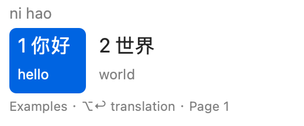
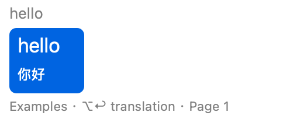

# Round 1 — State, commit and horizontal example candidates

Recorded: 2026-10-11, America/New_York.

Delivery: **IMPLEMENTED_AND_BUILT_WITH_RUNTIME_ACCEPTANCE_PENDING**.
Only Round 1 is authorized. Stop before Round 2; no push, release or replacement
of the installed Round 0 bundle was performed.

## 1. Objective and boundary

Define the [key contract](KEY_CONTRACT.md), centralize composition/host insertion,
and adapt the existing Squirrel Panel/View to horizontal candidate columns with
two lines per candidate. The user selected Option+Return for translated commit.
Use deterministic examples to validate association and cancellation; do not
introduce a real dictionary, API, context detector, new UI framework or provider.

## 2. Changed files and ownership

| Files | Change |
| --- | --- |
| `sources/CompositionState.swift` | New copied candidate values, focus/revision tokens, English token state, shared key policy and commit coordinator. |
| `sources/ExampleTranslation.swift` | Ten hand-authored exact-match examples per direction, with delayed delivery. Not a dictionary. |
| `sources/BilingualCandidateLayout.swift` | Shared horizontal geometry, hit testing, screen clamping and two-line rendering. |
| `sources/SafeIMEClient.h`, `.m` | Optional selector checks, NSNotFound replacement, Objective-C exception containment, validated caret geometry. |
| `sources/SquirrelInputController.swift` | Integrate state, primary/raw/translated commit, mode/focus invalidation, examples toggle and stale-result guards. |
| `sources/SquirrelPanel.swift`, `SquirrelView.swift` | Reuse the existing panel/view; nonactivating horizontal layout, same-column mouse selection and subtitle refresh. Retain status rendering and scroll gesture behavior. |
| `sources/Main.swift`, `SquirrelApplicationDelegate.swift`, bridging header | Engine reset/quit notification invalidates controllers before engine teardown; bridge the safe host adapter. |
| `Squirrel.xcodeproj/project.pbxproj` | Add source files; development bundle version 0.0.2; no new dependency. |
| `tests/Round1Checks.swift`, `SafeIMEClientChecks.m` | Core/policy/layout and production host-wrapper tests; synthetic inputs only. |
| `tools/check_round1.py`, `RimeSmoke.c`, `round0.py` | Fresh-output checks, isolated optional engine checks, current-status verifier link. Preserve absent-target install and no-cleanup rules. |
| `docs/project/*`, `docs/round1/*`, `AGENTS.md`, README and change record | Authorization, decisions, measured evidence, manual carryovers and GPL modification record. |

## 3. Complete implementation and key decisions

The source files above are complete, compiled implementations, not pseudocode.
Start at [CompositionState.swift](../../sources/CompositionState.swift),
[SquirrelInputController.swift](../../sources/SquirrelInputController.swift),
[BilingualCandidateLayout.swift](../../sources/BilingualCandidateLayout.swift)
and [SafeIMEClient.m](../../sources/SafeIMEClient.m).

Each controller owns state on the IMK/UI thread. Snapshots carry a session UUID,
focus generation, composition revision and candidate index. Fixture tasks receive
copied values; they cannot retain the host client. Cancelled, out-of-order,
deactivated and replaced-field results are rejected by identity checks. The
80 ms fixture delay exercises asynchronous refresh; it is not a latency result.

All text insertion passes through the coordinator. It invalidates state before
external marking/insertion, checks the bound client/generation again, and never
retries an uncertain host result. Raw/translated finalization clears the Rime
composition before insertion; ordinary engine commits retain partial-selection
behavior. Objective-C exceptions require an ObjC wrapper rather than Swift
do/catch. Missing selectors and exceptions return failure without logging text.
This cannot forcibly interrupt synchronous IMK IPC or contain native crashes.

The displayed primary, engine comment and subtitle are separate. Translated
insertion requires the ready value on the current panel, the current candidate
identity, an engine selection spanning the whole preedit, and a full preview
equal to the primary text. Partial candidates can display an example but cannot
submit it as a whole-composition translation. Space/digit selection validates
the displayed descriptor while retaining the engine's recognizer semantics.

The existing nonactivating NSPanel remains the only candidate window. Filled
highlight indicates keyboard selection; a hover outline indicates a click
target. Subtitle refresh preserves candidate IDs, page and both indicators.
Mouse press/release must refer to the same identity. Long lines truncate in
their own columns; screen-edge placement uses Cocoa points and visible frames.
Initial rendering uses the inherited font/background/alpha; complete theme
parity, candidate accessibility and actual multiple-display/DPI acceptance remain
later validation work.

## 4. Build, installation and verification

Tested environment: macOS 26.5, arm64, Xcode 26.6, SDK 26.5, Swift 6.3.3 using
Swift language mode 5 and deployment target 14.0. This is not macOS 14 runtime
or Intel support evidence.

The final artifact is:

```text
.artifacts/builds/round1-final/DerivedData/Build/Products/Debug/EcholME.app
```

Build the current source into a new directory (omit IDs for unique defaults):

```sh
cd /Users/zhenkun/GitHub/LiangYi-EcholME
python3 -B tools/round0.py build --configuration Debug
python3 -B tools/check_round1.py
```

The final recorded checks also use the built library/resources in independent
LiangYi validation directories:

```sh
python3 -B tools/check_round1.py --run-id round1-final-checks \
  --engine-bundle .artifacts/builds/round1-final/DerivedData/Build/Products/Debug/EcholME.app
```

That recorded run ID now exists; select a fresh ID for another run. This option
permits normal engine-managed generation/database maintenance only in fresh
`~/Library/Application Support/LiangYi/Validation/<id>/Rime/` and
`~/Library/Logs/LiangYi/Validation/<id>/`. It does not use the installed user
dictionary or Squirrel data. Generated files are retained; no cleanup runs.

| Verification | Outcome and evidence boundary |
| --- | --- |
| Final xcodebuild, ad-hoc signature, resource/identity/link checks | PASS; [build evidence](evidence/build-verification.json). |
| Compiler/linker warnings | None. One inherited AppIntents metadata extraction warning remains; no AppIntents dependency is used. |
| Shared state/key-policy/commit/layout checks | 50 PASS, warnings treated as errors; fake host, no IMK IPC. |
| Production Objective-C host wrapper | 22 PASS; absent selectors, exact replacement ranges, exceptions, wrong return type and invalid geometry. No real host IPC. |
| Tool safety guards | 12 PASS; mocked filesystem/network/process guards. |
| Existing output/data refusal | 2 PASS; actual runner/engine refusal before compilation/initialization; validation directory fingerprints unchanged. [Evidence](evidence/existing-output-guards.json). |
| Real pinned librime | 10 cycles / 60 checks PASS: Space, numeric choice, Esc, whole preview, clear without original, partial scope rejection. Engine only. |
| Production renderer previews | PASS by visual inspection of generated synthetic snapshots; horizontal columns, matching two lines and no vertical list. Not an installed panel screenshot. |
| Installed-bundle preservation | PASS for recorded critical-file comparison against the retained Round 0 fixed artifact. The older initial-install manifest predates the path fix. Not a system-wide filesystem trace. |
| New bundle installation / Notes / Xcode / Terminal IMK input | NOT_RUN. The existing installed bundle is still Round 0. See [manual steps](MANUAL_ACCEPTANCE.md). |
| Real latency, focus/mouse behavior, multiple displays/DPI | NOT_RUN. Geometry/core checks do not replace these measurements. |
| macOS 14, Intel, running Squirrel coexistence | NOT_RUN. |
| Remote CI, push, external release/notarization | NOT_RUN / NOT_AUTHORIZED. |

The initial `round1-state-ui-01` build failed because a cancellation helper
collided with an inherited IMK method. It was renamed and the actual override
implemented. Intermediate outputs remain in `.artifacts`; the final build and
evidence cover the corrected source. [Checks](evidence/checks-verification.json)
and [source hashes](evidence/source-sha256.json) identify final verification.

These images use the production renderer with hand-authored synthetic candidate
snapshots. They demonstrate pairing/layout; they are not real `nihao` engine
rankings or screenshots of the installed IME:




To install, first follow the manual source-switch/quit/user-removal steps. Only
after the target is absent:

```sh
python3 -B tools/round0.py install-first \
  --bundle .artifacts/builds/round1-final/DerivedData/Build/Products/Debug/EcholME.app
"$HOME/Library/Input Methods/EcholME.app/Contents/MacOS/EcholME" --register-input-source
```

These installation/registration commands were **not run for Round 1**. The
installer refuses an existing target; it does not replace or remove the old app.

## 5. Limits, GPL work and next gate

Round 1 is an engineering delivery with actual IMK acceptance pending. Fixture
misses show `—`; pending results show `…`. Option+Return on missing/pending/unsafe
examples is consumed without insertion. The ten examples per direction provide
neither dictionary coverage nor real translation quality. English composition is
one ASCII word/token, limited to 256 characters; no multiword phrase buffer,
automatic context, cloud provider, full mode HUD/settings or persistent example
preference is included. Example Off is per controller and resets for a new one.

GPL notices and upstream history remain preserved. Added files carry GPL-3.0-only
notices, modified upstream files carry modification/date records, and the build
continues including dependency/data license materials. No dependency or dataset
was added. Fixtures are authored in this source tree. Before external binary
distribution, still complete the exact corresponding-source/dependency/data
closure, scripts, notices and checksum review described in
[THIRD_PARTY_NOTICES.md](../../THIRD_PARTY_NOTICES.md); the local build is not a
distribution-ready release.

Complete the [manual acceptance matrix](MANUAL_ACCEPTANCE.md) on this bundle.
Wait for the user's explicit confirmation before Round 2's licensed offline
bidirectional dictionary, cache/cancellation/timeouts and quality/latency work.
No push is authorized.
